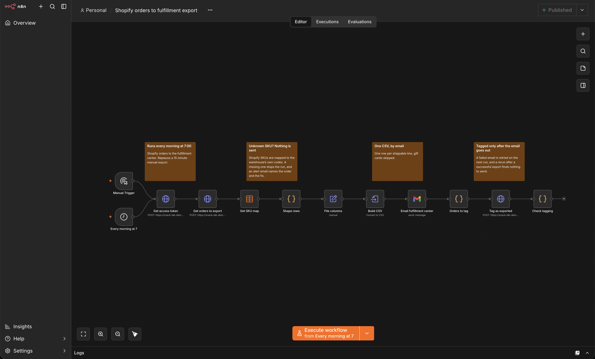
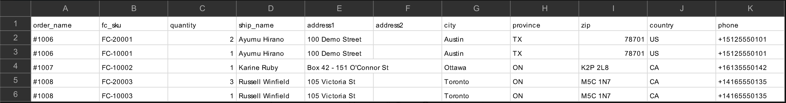
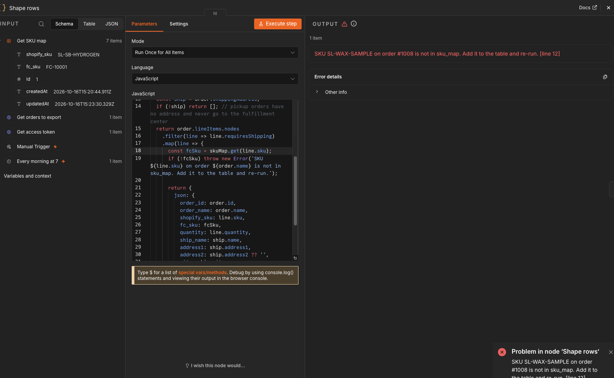
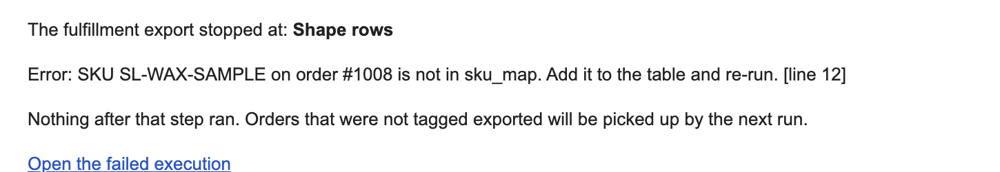
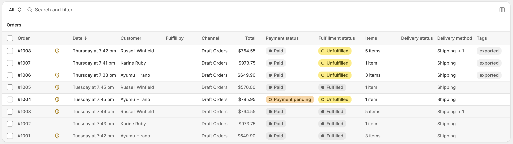

# Shopify orders to fulfillment export


An n8n workflow that sends every paid, unfulfilled Shopify order to the fulfillment center every morning, never skips one, and emails you when it can't run.

Built and tested against a Shopify development store ("Snack Lab") with synthetic orders.

It replaces a manual morning routine: export the orders from Shopify, reshape them into the warehouse's format, email the file, and remember which orders already went out.



## What it does

1. At 7:00 (America/New_York) it gets a fresh Shopify Admin API token through the client credentials grant. The token lasts 24 hours, so every run asks for a new one.
2. It queries the orders that are paid, unfulfilled and not tagged `exported`.
3. It builds one row per shippable line item. Gift cards and pickup orders are skipped, and each Shopify SKU is translated to the warehouse's own code through an n8n Data table (`sku_map`).
4. It converts the rows to a CSV and emails it to the fulfillment center with the Gmail node.
5. It tags each exported order `exported` and checks Shopify's `userErrors`, because GraphQL answers HTTP 200 even when a mutation is rejected. Orders it skipped (pickup, gift card only) are left untagged.



## Design decisions

- **Tag only after the email is sent.** If the email fails, nothing is tagged and the next run retries. If tagging fails after a successful send, the next run sends those orders again. A duplicate shipment is easier to catch than a missing one, so the workflow errs toward duplicates (at least once delivery).
- **An unknown SKU stops the run.** A row the warehouse can't map is a shipment that silently never happens, so the run stops before anything is sent and the alert names the order and the missing SKU.
- **An order with more than 50 lines stops the run** instead of being tagged with lines missing.
- **Customer text can't become a spreadsheet formula.** Name and address fields that start with `=`, `+`, `-` or `@` get a leading apostrophe, so Excel shows them as text.
- **Every failure sends an alert** through a separate n8n error workflow, with the failed step, the error and a link to the execution.
- **Least privilege.** The Shopify app has `read_orders` and `write_orders` only, plus protected customer data access to name, address and phone (not email). It has no products scope: line items keep the SKU from the moment the order was placed.

## The failure path

A SKU missing from `sku_map` stops the run at `Shape rows`, before any file is built or sent:



The error workflow emails the alert:



Add the SKU to the table and the next run exports the order. Nobody edits the workflow.

After a successful run the exported orders carry the tag, so a second run finds nothing:



## Files

| File | Purpose |
|---|---|
| `workflows/shopify-orders-to-fulfillment-export.json` | The export, on a daily schedule plus a manual trigger |
| `workflows/fulfillment-export-failure-alert.json` | The error workflow that emails alerts |
| `workflows/demo-reset-untag-exported-orders.json` | Removes the `exported` tag so a demo can be rerun |

## Setup

1. **Shopify app.** In the Shopify Dev Dashboard, create an app with the `read_orders` and `write_orders` scopes. In the Partner Dashboard, under API access requests, request protected customer data and then the Name, Address and Phone fields. Install the app on your store and note its client ID and client secret.
2. **n8n credentials.**
   - `Shopify store`: a Custom Auth credential that adds the app's keys to the body of the token request:
     ```json
     { "body": { "client_id": "YOUR_CLIENT_ID", "client_secret": "YOUR_CLIENT_SECRET" } }
     ```
   - `Gmail demo`: a Gmail OAuth2 credential. Its Google Cloud project needs the Gmail API enabled. If the consent screen stays in Testing mode, Google expires the refresh token after 7 days.
3. **SKU map.** Create an n8n Data table named `sku_map` with two string columns and one row per product variant:

   | shopify_sku | fc_sku |
   |---|---|
   | SL-SB-HYDROGEN | FC-10001 |
   | SL-WAX-STD | FC-20001 |
   | SL-WAX-SAMPLE | FC-20003 |

4. **Import** the three JSON files, then:
   - replace `your-store.myshopify.com` in every HTTP Request node with your store's domain,
   - select the `sku_map` table in `Get SKU map`,
   - replace `fulfillment@example.com` and `alerts@example.com` with real addresses,
   - open each node that shows a credential warning and select your credential (the files carry credential names, not IDs).
5. **Publish the alert workflow first**, then pick it under the export workflow's Settings, Error Workflow (n8n 2.x lists only published workflows there). Check the timezone in the same Settings (the file sets `America/New_York`), then publish the export workflow.

## Testing

- **Happy path:** run the export by hand. Expect one email with the CSV and the `exported` tag on each order. Run it again: it finishes after `Shape rows` with no items and sends nothing. That is a normal run, not an error.
- **Reset:** run `Demo reset: untag exported orders` to put the exported orders back in the queue. Use it on a demo store only: it removes the tag from every exported order, so on a live store the next run would send them all again.
- **Failure path:** run Reset, rename a SKU in `sku_map`, and run the export. It stops with an error at `Shape rows` and nothing is sent. Alerts fire only on production (scheduled) runs, not on manual runs from the editor.

## Limits

- **Delivery is CSV by email.** The fulfillment center's real format and channel (email, SFTP or its own API) would replace the Gmail node; everything before it stays the same.
- **50 orders per run.** Orders beyond the first 50 wait for the next run. Skipped orders (pickup, gift card only) stay untagged until they are fulfilled in Shopify, so a pile of them can fill that window.
- **One Gmail credential.** The export and the alert share it. If its token expires, the export fails and the alert can't be sent either.
- **An empty `sku_map` ends the run quietly.** With no rows, `Shape rows` never runs, so nothing is sent and no alert fires.
- **Manual runs share the path.** A manual run at the same moment as the 7:00 run can send the same orders twice.
- **Excel and the CSV.** Opening the file in Excel strips the `+` from phone numbers and leading zeros from ZIP codes. Systems that import the raw text are unaffected.

## License

MIT, see [LICENSE](LICENSE).

## Author

**Brian Ramírez**, [github.com/dominicci13](https://github.com/dominicci13)  
[linkedin.com/in/bdramirez](https://www.linkedin.com/in/bdramirez)
